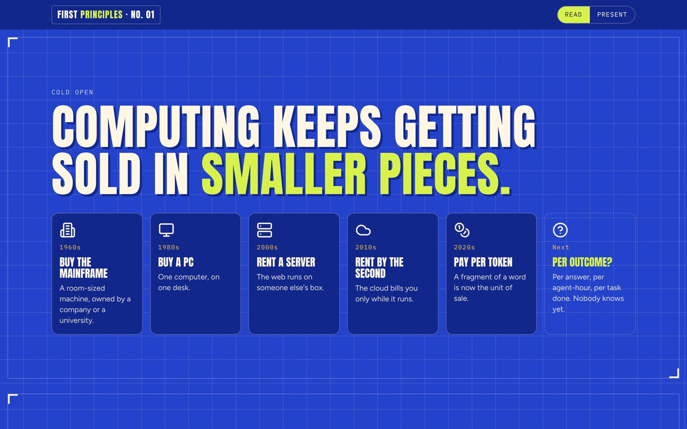
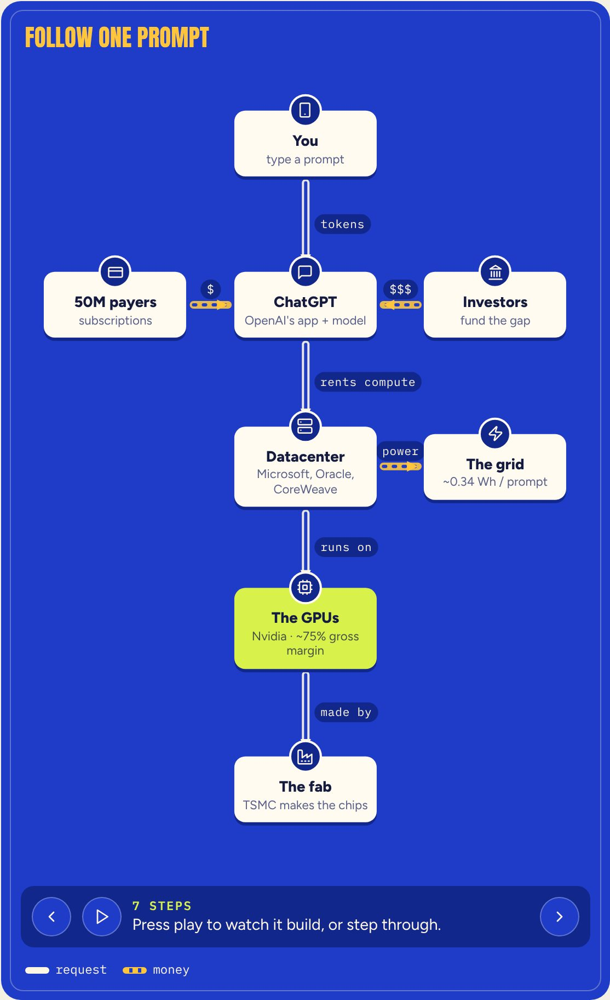
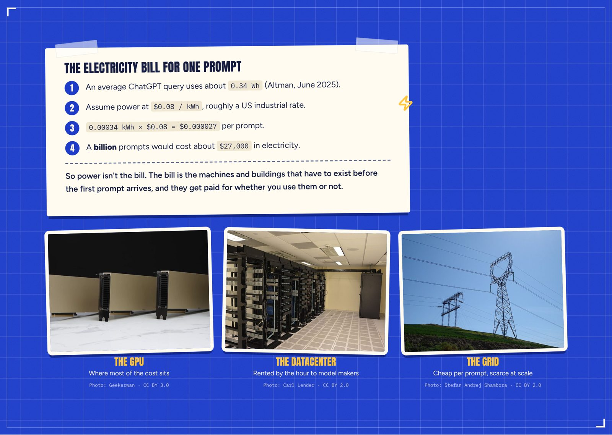
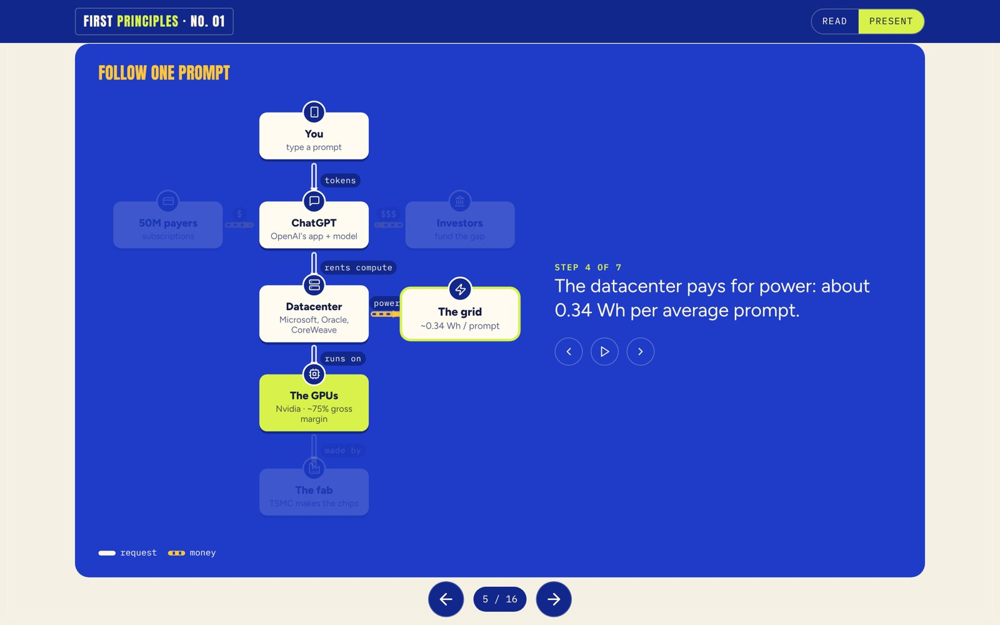

# wtf-explainer

A Claude skill that explains any concept from first principles in the style of Nikhil Kamath's **WTF** podcast. Ask it about a concept and it returns one HTML page with:

- question-led chapters
- one transaction followed through every actor in the system, with the money traced back
- architecture diagrams that build one actor at a time
- charts that are drawn to scale and cite their sources
- real photos

The page reads like an article. Press **Present** and it becomes a slide deck.



| Build-up flow diagram | Back-of-envelope + real photos | Present mode |
|---|---|---|
|  |  |  |

The worked example is [`examples/who-pays-for-your-prompt`](examples/who-pays-for-your-prompt/index.html): *"If most people use ChatGPT for free, who pays for your prompt?"* Open the file in a browser.

## How it was built

I didn't want a skill that guesses what "WTF-style" means, so I reverse-engineered five episodes:

| Episode | Why it's in the set |
|---|---|
| WTF is Payments? (PhonePe, Razorpay, NPCI) | Newest production; diagrams build in a side panel |
| WTF is AI? (who pays for the AI boom) | Same topic as the worked example, so the two can be compared |
| WTF is Travel? (MakeMyTrip × Taj) | Two-sided market explained from both ends |
| WTF is Happening with EV? | Older style with full-screen explainer cards |
| WTF are Indian Real Estate Giants Up To? | A skeptical host and a bull-vs-bear structure |

The pipeline (`scripts/pipeline/`):

1. **Captions + video.** `yt-dlp` downloaded timestamped captions and a 360p copy of each episode: about 174K words in total.
2. **Frames.** `ffmpeg` took one keyframe every 4 seconds, about 14,600 frames.
3. **Find the graphics.** Most frames are talking heads, so three filters dig out the graphics:
   - a flatness score (graphics use flat color)
   - frames with no face in them (OpenCV)
   - a detector for the split-screen layout, where a diagram panel sits beside the speaker
4. **Read the conversations.** One agent per episode extracted a fixed schema (`episode_schema.md`): the hook, the question ladder, the first-principles moves, the numbers, and every moment the dialogue implied a diagram.
5. **Synthesize.** The patterns that recurred across episodes became the skill.

What showed up again and again:

- **History compressed into one repeating move.** "Money keeps getting *lighter*."
- **Follow one ₹100 through every actor**, then ask *who pays, and why would they?*
- **"Why is this layer here?"** asked at every hop. The leftover layers are often the insight.
- **A where-every-rupee-goes waterfall** that overturns a common belief.
- **What you see vs what actually happens.**
- **A real disagreement between guests**, then where the host lands.
- **"If I were 25, what would I build?"** and "the lessons I've written down".
- **Visually:** one saturated color per topic, paper grain, a frame themed to the subject (a banknote border for payments), chunky condensed caps, and one lime highlight on the thing to look at.

## What's in here

```
SKILL.md                  # the complete skill: workflow, playbook, template, photo script
template/index.html       # the page engine with a skeleton scene for every component
scripts/commons.py        # finds and downloads freely licensed photos from Wikimedia Commons
scripts/pipeline/         # the episode-analysis pipeline above
examples/who-pays-for-your-prompt/
docs/                     # screenshots
```

## Use it

- **Claude Code:** put `SKILL.md` at `~/.claude/skills/wtf-explainer/SKILL.md`.
- **Claude apps:** upload `SKILL.md` as a custom skill.

Then ask for something like:

> Make a WTF-style explainer on how credit card rewards are actually funded.

The skill asks one question first: page, slides, or both (the default is both). Then it:

1. researches the topic, giving every number a source and a date
2. storyboards the episode arc
3. picks a color world for the topic
4. builds the page from the template and publishes it

### Components

| When the idea is… | It draws |
|---|---|
| One transaction through many actors | `flow`: a build-up diagram with step captions (arrow keys in Present mode) |
| Where each 100 of money goes | `waterfall` |
| Who's big vs who's earning | `bars`, with one highlighted bar and a source pill |
| An industry's layers and margins | `stack` |
| Players on two axes | `quad` (2×2) |
| History | `eras`, ending in "?" |
| Illusion vs reality, then vs now | `versus` |
| Live arithmetic | `note`, a taped paper card |
| Physical things | `stickers`, real photos with credits |
| A disagreement | `debate`, with a verdict |

Each component reads JSON from a `<script type="application/json">` block, so the content stays separate from the layout.

## Notes

- **Unofficial fan project.** Not affiliated with WTF, Nikhil Kamath, Zerodha or Gruhas. The skill learns the structure and the visual grammar. It does not reuse their logo, artwork or voice, and it never puts words in a real person's mouth.
- **What's left out.** The transcripts, frames and per-episode notes used for the analysis aren't in this repo. Run the pipeline yourself to rebuild them.
- **Example photos** come from Wikimedia Commons under their own licenses (CC BY 2.0 / 3.0). Authors are credited on the page and listed in the example's sources.

## License

MIT for the code and the skill. See [LICENSE](LICENSE).
